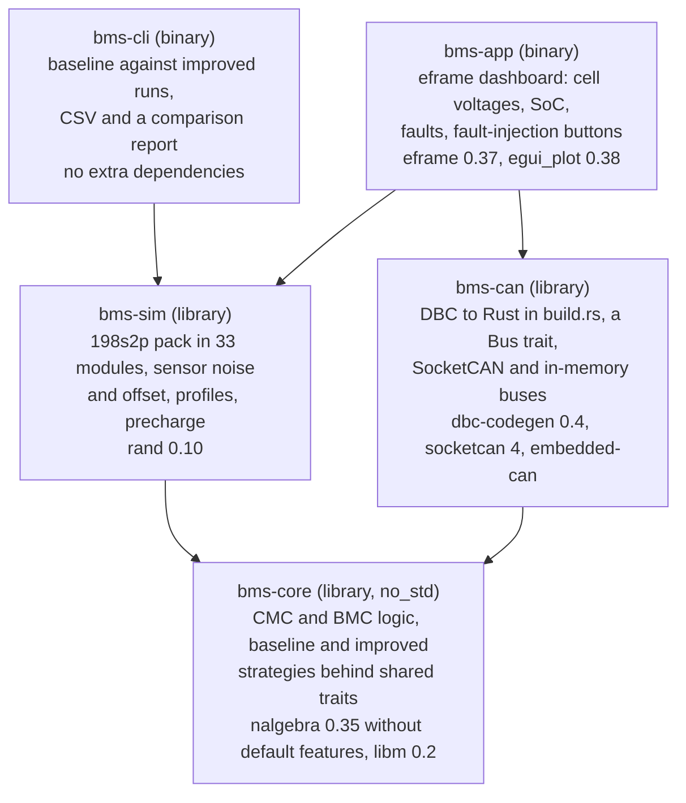
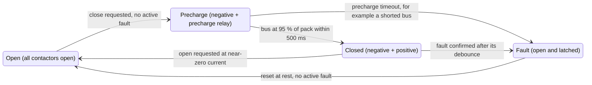

# BMS in Rust: project plan

*Plan as of 6 November 2026.*

## Goal and scope

Version 1 is two battery management systems in Rust for one simulated pack modeled on the first-generation Taycan Performance Battery Plus: a baseline built from conventional algorithms, and an improved BMS that has to beat it on the same scenarios. Both keep the BMS logic in a `no_std` crate and the battery in a separate simulation, and version 1 is done when every milestone check passes.

In scope for v1:

- Cell model (equivalent circuit) scaled to the Taycan's 64.6 Ah cell, in a 198s2p pack of 33 modules with cell-to-cell spread, sensor noise and sensor offsets
- SoC estimation: Coulomb counting with OCV correction (baseline), then an extended Kalman filter per cell (improved)
- Protection: over- and under-voltage, over-current, over- and under-temperature, with debounce and fault latching
- Contactor control with precharge, and power limits: fixed derating tables (baseline) against model-based state of power (improved)
- Passive cell balancing: voltage-based at rest (baseline), SoC-based while driving and charging (improved)
- A CAN interface defined in a DBC file, on a virtual bus
- A live dashboard in egui, plus headless scenario runs that write CSV

Later, not in v1: a thermal model, a fast-charge strategy, state of health per module, LFP with hysteresis, and the BMS running on a real microcontroller against the simulated pack.

Choices made for you, easy to change: the first-generation pack, because Porsche published its cell count, cell capacity and voltage range; NMC chemistry, as in its LG E66A cells (NMC712); simulation before hardware.

## Baseline: the Taycan battery as published

The baseline is the first-generation Taycan Performance Battery Plus, rebuilt from what Porsche and cell benchmarkers have published, managed by a conventional BMS that you write first. Porsche's BMS software and calibration are not public, so every result compares your improved BMS with your baseline, never with Porsche's real system.

| Public item | Value | Source |
| --- | --- | --- |
| Layout | 33 modules of 12 pouch cells, 396 cells, 198s2p | [Porsche technical specifications](https://newsroom.porsche.com/dam/jcr:b9255ec0-890c-40e9-b79e-f3a66301dd81/TaycanTechnicalSpecSheet_210120Final.pdf) |
| Pack | 723 V nominal, 129 Ah, 93.4 kWh gross | [Porsche technical specifications](https://newsroom.porsche.com/dam/jcr:b9255ec0-890c-40e9-b79e-f3a66301dd81/TaycanTechnicalSpecSheet_210120Final.pdf) |
| Voltage range | 610 to 835 V | [Porsche: The Taycan battery](https://porsche.com/pap/aboutporsche/e-performance/magazine/taycan-battery) |
| Usable energy | 83.7 kWh | [km77 technical data](https://km77.com/coches/porsche/taycan/2020/estandar/informacion/porsche-taycan-2020-informacion-tecnica) |
| Cell | LG E66A pouch cell: NMC712, 64.6 Ah, 3.657 V nominal, 4.2 V maximum, 2.5 V cut-off; DCIR 1.37 mΩ at 50 % SoC and 25 °C | [km77](https://www.km77.com/coches/porsche/taycan/2020/estandar/informacion/porsche-taycan-2020-informacion-tecnica?amp=1), [Battery Design: LG E66A](https://www.batterydesign.net/lg-e66a/) |
| Cell current limits | 121 A continuous and 297 A pulse discharge, 167 A charge | [Battery Design: LG E66A](https://www.batterydesign.net/lg-e66a/) |
| Fast charging | peak 270 kW; 10 to 80 % in 21.5 min | [inkl](https://www.inkl.com/news/porsche-reveals-battery-secrets-that-make-the-taycan-go-further-and-charge-faster), [Electric Cars Report](https://electriccarsreport.com/2025/12/this-is-how-porsche-made-the-taycan-charge-faster-and-drive-farther/) |
| BMS architecture | a battery management controller (BMC) plus cell module controllers (CMCs) inside the modules; the CMCs report cell voltages and temperatures and balance the cells; the BMC uses its own current sensors and keeps the battery inside its limits | [Porsche Engineering, 2023](https://newsroom.porsche.com/en/2023/innovation/porsche-engineering-in-feel-good-mode-battery-management-systems-32389.html) |

What follows from those numbers (my arithmetic):

- Each module is 6s2p (198 series elements over 33 modules), so each CMC measures 6 voltages, each across two parallel cells.
- A series element averages 3.652 V (723 / 198), and the soft window is 3.08 to 4.22 V (610 / 198 and 835 / 198).
- 89.6 % of the gross energy is usable: a 10.4 % buffer whose split between top and bottom Porsche does not publish.
- 270 kW and the E66A's 167 A charge limit (334 A per pack) meet at 808 V, about 4.08 V per series element.

The baseline BMS uses the conventional algorithms of an open automotive-grade platform, [foxBMS 2](https://iisb-foxbms.iisb.fraunhofer.de/foxbms/docs/latest/software/modules/application/algorithm/state-estimation/state-estimation.html) from Fraunhofer IISB, whose software is BSD-3-Clause: SoC by Coulomb counting initialised from an OCV lookup, power limits from trapezoid derating, and voltage-based balancing. Read those pages before writing the baseline.

One more public detail sets up M6: Porsche's [service information](https://static.nhtsa.gov/odi/tsbs/2026/MC-11033647-0001.pdf) for 2020 to 2024 Taycans lists a BMC fault "Cell module x, ageing detected", so module health monitoring is part of the real BMC.

## Baseline against improved

Both BMSs implement the same traits and run the same scenarios on the same simulated pack, and a report from bms-cli decides which is better. The improved column is where your thesis background pays off: estimation and model-based design.

| Function | Baseline | Improved | Metric |
| --- | --- | --- | --- |
| SoC | Coulomb counting, OCV correction after long rests | EKF per series element | SoC error over a drive cycle with a current-sensor offset, RMS and maximum |
| Usable energy | SoC window sized for the baseline's SoC error | the same margin over a smaller error, so a wider window | kWh delivered before a limit is reached |
| Power limits | trapezoid derating over SoC and temperature | model-based state of power: the largest current that keeps every cell inside 3.08 to 4.22 V for the next 10 s | energy and power delivered without a limit violation |
| Balancing | voltage-based, at rest only | SoC-based, also while driving and charging | time and energy to bring a 2 % spread under 0.5 % |
| Module health (M6) | fault when a module's voltage deviates by a fixed margin | online capacity and R0 per module | how early an injected weak module is flagged, and false alarms |

Two rules keep the comparison fair:

- The improved BMS may only shrink the part of the buffer that covers SoC uncertainty, at the same chance of hitting a hard limit.
- Both see the same sensor noise, offsets and seeds, and each experiment changes one thing.

Balancing is the baseline's weak spot at this scale: a 2 % SoC spread on a 64.6 Ah cell is 1.29 Ah, which takes 12.9 h of bleeding at 100 mA.

## Reference cell and pack model

The cell is a 2RC equivalent circuit sized like the LG INR18650HG2, a 3 Ah NMC cell with a public test dataset. Every value in the checks table came from a Rust prototype run of this exact model, so your tests can assert them.

Datasheet limits the BMS enforces ([HG2 specification](https://files.batteryjunction.com/frontend/files/lg-hg2-18650.pdf)): charge voltage 4.20 V ± 0.05 V; standard charge 1.5 A, maximum 4 A; charge cut-off current 50 mA; discharge end voltage 2.5 V; maximum continuous discharge 20 A. The temperature limits used here are the tighter set the document gives in section 5.1: charge 0 to 45 °C, discharge −20 to 60 °C.

With i > 0 meaning discharge, and Δt the step:

```math
z_{k+1} = z_k - \frac{\Delta t}{3600\,Q}\, i_k, \qquad v_{j,k+1} = e^{-\Delta t/\tau_j}\, v_{j,k} + R_j \left(1 - e^{-\Delta t/\tau_j}\right) i_k \quad (j = 1, 2)
```

```math
v_k = \mathrm{OCV}(z_k) - R_0\, i_k - v_{1,k} - v_{2,k}
```

These steps are exact for a current held constant over Δt, so the plant and the EKF can share them.

| Parameter | Value | Note |
| --- | --- | --- |
| Q | 3.0 Ah | HG2 nominal capacity |
| R0 | 20 mΩ | illustrative; the datasheet gives ≤ 20 mΩ AC at 1 kHz |
| R1, τ1 | 15 mΩ, 15 s | illustrative |
| R2, τ2 | 15 mΩ, 300 s | illustrative |
| Pack | 16S1P | spread, uniform: capacity ±2 %, R0 ±10 %, initial SoC ±2 % |
| Sensors | 2 mV and 20 mA noise (1σ) | plus a 30 mA current offset |

The OCV curve below is illustrative, with a typical NMC shape; it is not measured data. M6 replaces it and the RC values with ones fitted to the HG2 dataset.

```csv
soc,ocv_v
0.00,3.00
0.05,3.40
0.10,3.52
0.20,3.60
0.30,3.65
0.40,3.70
0.50,3.75
0.60,3.82
0.70,3.90
0.80,3.98
0.90,4.07
0.95,4.13
1.00,4.20
```

| Check (assert in a test) | Expected value |
| --- | --- |
| Rest voltage at 100 % | 4.200 V |
| Instant drop at 3 A | 60 mV (R0 · I) |
| 1C (3 A) discharge from 100 % to 3.0 V, 1 s steps | about 3533 s (58.9 min), ending at 1.86 % SoC |
| Relaxation after that cut-off | 3.059 V at once, 3.090 V after 15 s, 3.149 V after 1 h |
| 10 s pulse at 6 A from 50 %, rested | 3.7500 V to 3.6300 V at once, 3.5805 V after 10 s |
| CC-CV from that cut-off: 1.5 A to 4.20 V, stop at 50 mA | CC phase about 111 min, total about 137 min, ends at 99.75 % |

### Scaling to the Taycan-like pack

For the pack, scale the same model to the 64.6 Ah E66A cell: capacity × 21.53, every resistance ÷ 21.53, time constants and OCV shape unchanged. As a sanity check, a 10 s pulse on the scaled model gives a DC resistance of 1.29 mΩ, within 6 % of the 1.37 mΩ published for the E66A (that source does not state its pulse length). Replace these values with fitted ones when you can (M6).

| Parameter | 64.6 Ah cell | Series element, 2 in parallel |
| --- | --- | --- |
| Q | 64.6 Ah | 129.2 Ah |
| R0 | 0.929 mΩ | 0.464 mΩ |
| R1, R2 | 0.697 mΩ each | 0.348 mΩ each |
| τ1, τ2 | 15 s, 300 s | 15 s, 300 s |

Pack R0 is about 92 mΩ (198 × 0.464 mΩ). A full pack rests at 831.6 V (198 × 4.20 V), inside Porsche's 835 V maximum.

## Workspace and crate layout

Five crates in one Cargo workspace, arranged so that everything a real ECU would run sits in bms-core, which depends only on nalgebra and libm. Baseline and improved are two sets of trait implementations inside bms-core, chosen per run, so both see identical inputs.

Arrows point from a crate to the crates it depends on. Everything above bms-core simulates or displays; bms-core is the ECU.



bms-sim reuses the cell model from bms-core for the plant, with each cell's own parameters, while the EKF in bms-core uses nominal ones. bms-can turns bms-core's outputs into DBC frames, so the same core later runs on a microcontroller unchanged. Checked versions are listed under learning resources.

## First weekend goal

By Sunday evening the repo has a green CI run, and bms-core has a tested single-cell model that passes the first five rows of the checks table. Spend a few hours on chapters 1 to 5, 11 and 14 of the Rust Book first.

1. Create the workspace with bms-core (library, `no_std` from the first commit) and bms-cli (binary), plus the CI workflow from the repo setup section. Start bms-core with `#![cfg_attr(not(test), no_std)]`, so its unit tests can still use std.
2. In bms-core: the OCV table with linear interpolation, extrapolating past both ends rather than clamping; a `CellParams` struct; a `CellState` with soc, v1 and v2, and methods `step(&params, i, dt)` and `terminal_voltage(&params, i)`, which take the parameters so the plant can use each cell's own and the EKF nominal ones.
3. Use `libm::exp` for the RC factors: `f64::exp` is not available in a `no_std` crate, just like `f64::powi`.
4. Tests for the rest voltage, the R0 drop, the 1C discharge time, the relaxation and the pulse, using `approx::assert_relative_eq!`.
5. In bms-cli, run the 1C discharge and write t, i, v and soc to a CSV; plot it in MATLAB or Python.

Done when:

- [x] `cargo test` passes the five model checks
- [x] CI is green on GitHub, including the `no_std` build of bms-core
- [x] the discharge plot has a flat middle and a knee near empty, like a real cell

Rust you meet here: workspaces, structs and impl blocks, const arrays, `#![no_std]` with libm, unit tests, file output.

## Milestones

Six milestones after the first weekend, each ending in checks you can tick. M1 to M4 build each function twice, baseline and improved, against the simulated pack; M5 puts them on a CAN bus with a dashboard; M6 writes the comparison and grows from there.

### M1. Pack, sensors and charging

The Taycan-like pack: 33 modules of 6s2p built from the scaled 64.6 Ah cell, with parameter spread, and one CMC per module that reports its 6 series voltages and temperatures to the BMC. Add sensor models with noise and offset, a drive-like current profile and CC-CV charging; a scenario runner in bms-cli writes CSV.

Rust: const generics (a `Module<6>`), arrays of structs, `std::sync::mpsc` channels from the CMCs to the BMC, iterator min, max and sum, seeded rand 0.10 (`StdRng::seed_from_u64` and the `RngExt` trait).

- [ ] single cell, CC-CV from the 3.0 V cut-off: CC phase about 111 min, total about 137 min, ending at 99.75 %
- [ ] the charger tapers when the highest series element reaches its limit, not when the pack voltage does
- [ ] a full pack rests at 831.6 V (198 × 4.20 V), inside Porsche's 835 V maximum
- [ ] the same seed gives the same CSV

### M2. SoC estimation

Baseline: Coulomb counting on the BMC's pack current, initialised and corrected from the OCV table after long rests. Improved: one EKF per series element, 198 in all (recipe below). Both sit behind a `SocEstimator` trait.

Rust: traits and generics, nalgebra's fixed-size `Matrix3` and `Vector3`.

- [ ] single 3 Ah cell: Coulomb counting with a 30 mA offset drifts 1.00 % per hour and never fixes a wrong starting value
- [ ] on the pack, a 0.5 A offset on 129.2 Ah drifts 0.39 % per hour
- [ ] single cell, power-up after a long rest with a guess 40 % too low: the EKF is within 2 % after 2 s
- [ ] single cell, restart mid-drive with a guess 30 % off and σ0 = 5 %: within 2 % after 132 s when the guess was low, 1 s when it was high
- [ ] single cell, after converging on the 72-minute drive profile: RMS error 0.45 to 0.65 %, maximum 0.81 % (prototype, four runs)

### M3. Protection and contactors

Threshold checks with debounce and latching, and the contactor state machine with precharge (diagram below).

Rust: enums that carry data, exhaustive match, one pure `step(inputs) -> outputs` function that is easy to test, heapless for a fixed-size fault log.

- [ ] every fault opens the contactors only after its debounce time, and stays latched until a reset at rest
- [ ] precharge with 100 Ω and 470 µF reaches 95 % of the 831.6 V pack in 140.8 ms (τ = 47 ms), with an 8.3 A inrush and 163 J in the resistor; a shorted bus times out into Fault
- [ ] charging is refused below 0 °C in every state

### M4. Passive balancing

Baseline: bleed every series element more than 5 mV above the lowest one, at rest. Improved: balance on estimated SoC, also while driving and charging.

- [ ] one module of 3 Ah cells: from a 3.6 % SoC spread, the prototype got under 0.5 % in 0.9 h with 33 Ω bleed resistors (about 118 mA) and in 1.7 h with 68 Ω (about 57 mA)
- [ ] on the pack, a 2 % spread is 1.29 Ah per 64.6 Ah cell, 12.9 h at 100 mA: the improved strategy wins by balancing outside rest periods

### M5. CAN bus and dashboard

The DBC file becomes Rust types through dbc-codegen in a `build.rs`. The BMS and a small VCU stand-in run as separate processes on a virtual bus, and an eframe dashboard shows the pack live.

Rust: build scripts and generated code, a Bus trait with two implementations, processes and threads.

- [ ] `BMS_Status` round-trips through the generated code
- [ ] the dashboard shows cell voltages, true and estimated SoC, contactor state and faults, with buttons that inject faults
- [ ] on Linux, `candump` on `vcan0` shows the frames

### M6. The comparison report, then pick any

- The comparison report: every scenario run with both BMSs and scored on the metrics in the baseline against improved table.
- Module health: estimate capacity and R0 per module online, then measure how early an injected weak module is flagged.
- Charging calibration: tune the RC values until the baseline's 10 to 80 % time under a 270 kW cap lands near Porsche's 21.5 min, then try a better charge profile under the same limits.
- Temperatures for cells without a sensor: Porsche Engineering gives 60 sensors for 200 cells as an example of such sparse sensing.
- Fit the model to the HG2 dataset, which its authors published for testing Kalman filter SoC estimators.
- bms-core on an STM32 with CAN (Embassy), the pack still simulated on the PC.

## SoC estimation recipe

Run one EKF per cell, every second, on the same 2RC model as the plant but with nominal parameters. The cells carry their spread, so the filter meets realistic model error.

State `x = [z, v1, v2]`, input the measured current, output the measured cell voltage:

```math
x_{k+1} = F x_k + B\, i_k, \qquad F = \mathrm{diag}\!\left(1,\; e^{-\Delta t/\tau_1},\; e^{-\Delta t/\tau_2}\right), \qquad H_k = \left[\frac{d\,\mathrm{OCV}}{dz}(\hat z_k),\; -1,\; -1\right]
```

1. Predict: step x with the measured current (the model equations above), then P = F P Fᵀ + Q.
2. Update: innovation = v_meas − (OCV(ẑ) − R0 i − v1 − v2); S = H P Hᵀ + R; K = P Hᵀ / S; x += K · innovation.
3. Covariance in Joseph form, P = (I − K H) P (I − K H)ᵀ + K R Kᵀ, which keeps P symmetric and positive.
4. dOCV/dz is the slope of the active table segment. Clamp ẑ to a sane range after the update.

| Tuning (Δt = 1 s) | Value that worked in the prototype |
| --- | --- |
| Q | diag((1e-5)², 1e-8, 1e-8) per step |
| R | (10 mV)², five times the 2 mV sensor noise, to cover model error |
| P0 | diag(σ0², 1e-4, 1e-4): σ0 = 30 % after a long rest, 5 % when restoring a stored SoC |

After a long rest v1 and v2 are near zero, so the terminal voltage is the OCV and the first update snaps SoC to the table. That is why the 40 % wrong guess vanished in 2 s, and why a real BMS reads the OCV at power-up.

## Protection and contactor logic

Every hard limit comes from the HG2 datasheet; the debounce times are my starting values, not datasheet figures.

| Fault | Trips when | Debounce | Datasheet basis |
| --- | --- | --- | --- |
| Cell over-voltage | any cell above 4.25 V | 1 s | 4.20 V ± 0.05 V charge voltage |
| Cell under-voltage | any cell below 2.50 V | 1 s | 2.5 V discharge end voltage |
| Discharge over-current | above 20 A | 0.5 s | 20 A maximum continuous discharge |
| Charge over-current | above 4 A charging | 0.5 s | 4 A maximum charge current |
| Charge temperature | outside 0 to 45 °C while charging | 2 s | section 5.1 |
| Discharge temperature | outside −20 to 60 °C | 2 s | section 5.1 |

Add soft limits as well: the BMS should ask the VCU to stop discharging at the bottom of the soft window (3.0 V for the HG2-like cell, 3.08 V per series element on the Taycan-like pack), through a current-limit signal in the DBC, long before the 2.5 V fault opens the contactors.

For the Taycan-like pack, keep the voltage rows: the E66A's published 4.2 V maximum and 2.5 V cut-off match the HG2's. Keep the temperature rows as an assumption, since the E66A data gives no temperature range. Replace the two current rows with the E66A limits for two cells in parallel: 242 A continuous and 594 A pulse discharge, 334 A charge.

A fault always opens the contactors; only a reset at rest clears it. Trip limits and debounce times are in the table above.



Precharge closes the negative contactor and the precharge relay; Closed adds the positive contactor and then opens the relay. Leaving Fault always passes through Open, so the next close repeats the precharge.

## GitHub repo setup

Push the M0 skeleton first: the workspace root, bms-core, bms-cli, the DBC file and CI. Add the other crates when their milestone arrives; `cargo new` inside the workspace folder adds each one to `members` by itself.

```text
rustbms/
├── Cargo.toml            [workspace], resolver = "3"
├── bms-core/             #![no_std]: cell model, EKF, protection, contactors, balancing
├── bms-sim/              pack plant, sensors, profiles, precharge circuit
├── bms-can/              DBC to Rust (build.rs), Bus trait, SocketCAN and in-memory buses
├── bms-app/              eframe dashboard
├── bms-cli/              headless scenarios to CSV
├── dbc/bms.dbc
└── .github/workflows/ci.yml
```

```yaml
name: CI
on: [push, pull_request]
jobs:
  check:
    runs-on: ubuntu-latest
    steps:
      - uses: actions/checkout@v7
      - uses: dtolnay/rust-toolchain@stable
        with:
          components: rustfmt, clippy
          targets: thumbv7em-none-eabihf
      - run: cargo fmt --all --check
      - run: cargo clippy --workspace --all-targets -- -D warnings
      - run: cargo test --workspace
      - run: cargo build -p bms-core --target thumbv7em-none-eabihf
```

The last step is the real `no_std` check. A build on your PC cannot prove it, because std is always available there; a Cortex-M4F target has no std at all. That target also matches the STM32 boards in M6.

A starting DBC with three messages, tested through dbc-codegen in the prototype:

```text
BO_ 1280 BMS_Status: 8 BMS
 SG_ PackVoltage : 0|16@1+ (0.02,0) [0|1310.7] "V" VCU
 SG_ PackCurrent : 16|16@1- (0.1,0) [-3276.8|3276.7] "A" VCU
 SG_ SoC : 32|8@1+ (0.5,0) [0|100] "%" VCU
 SG_ ContactorState : 40|3@1+ (1,0) [0|7] "" VCU
 SG_ FaultActive : 43|1@1+ (1,0) [0|1] "" VCU

BO_ 1281 BMS_CellStats: 8 BMS
 SG_ CellVmin : 0|16@1+ (0.0001,0) [0|6.5535] "V" VCU
 SG_ CellVmax : 16|16@1+ (0.0001,0) [0|6.5535] "V" VCU
 SG_ CellVminIdx : 32|8@1+ (1,0) [0|255] "" VCU
 SG_ CellVmaxIdx : 40|8@1+ (1,0) [0|255] "" VCU

BO_ 1536 VCU_Command: 2 VCU
 SG_ ContactorRequest : 0|1@1+ (1,0) [0|1] "" BMS
 SG_ ChargeEnable : 1|1@1+ (1,0) [0|1] "" BMS

VAL_ 1280 ContactorState 0 "Open" 1 "Precharge" 2 "Closed" 3 "Fault" ;
```

The full file, with the `VERSION`, `NS_`, `BS_` and `BU_: BMS VCU` header lines, is `dbc/bms.dbc`. PackVoltage uses 0.02 V per bit, so the 16-bit signal reaches 1310.7 V; at 0.01 V per bit it would stop at 655.35 V, below the 831.6 V full pack.

## Pitfalls and tips

The first two cost real debugging time in the prototype; the rest are traps worth knowing before they bite.

- **OCV at 100 % must equal the charge voltage.** With the table ending at 4.18 V, a 4.20 V CC-CV charge never tapered and ran the cell past 135 % SoC. Ending the table at 4.20 V, with linear extrapolation past both ends, made it stop at 99.75 %.
- **dbc-codegen setters truncate.** They compute ((value − offset) / factor) as i16 in f32, so −12.4 A with a 0.1 A scale went out as −12.3 A. Round yourself and use the generated `*_raw_val` setters.
- **Generated code has its own dependencies.** The crate that includes the dbc-codegen output needs bitvec and embedded-can. A `VAL_` table becomes an enum, so ContactorState is set as `BmsStatusContactorState::Closed`, not 2.
- **SocketCAN is Linux only.** `vcan0` will not exist on macOS or Windows, so put the bus behind a trait and use an in-memory bus there.
- **Keep std out of bms-core.** `f64::exp` and `f64::powi` do not exist without std (checked); use libm. rand, CSV writing and egui belong in the other crates.
- **One sign convention everywhere.** Pick i > 0 for discharge and use it in the model, the EKF, the protection limits and the DBC's signed PackCurrent; a flipped sign makes Coulomb counting run backwards.
- **Run scenarios with `--release`.** Debug builds are much slower, which you will feel once balancing runs simulate hours of rest.
- **Parallel cells share one voltage.** A 6s2p module gives its CMC 6 voltages, not 12. Model each series element as one 129.2 Ah cell unless you want to study a weak cell inside a parallel pair.
- **Keep Porsche's name out of the branding.** Name the repo something like bms-800v and describe the pack as modeled on published Taycan figures. Your results show an improvement over your baseline, not over Porsche's BMS, whose software is not public.

## Learning resources and sources

Read each row just before its milestone. Gregory Plett's Battery Management Systems, Volume II: Equivalent-Circuit Methods is the standard book behind M1 and M2.

| Milestone | Read | For |
| --- | --- | --- |
| First weekend | [Rust Book](https://doc.rust-lang.org/book/) chapters 1 to 5, 11 and 14; [libm](https://docs.rs/libm) | basics, tests, workspaces; `no_std` math |
| Before M1 | [foxBMS 2 state estimation](https://iisb-foxbms.iisb.fraunhofer.de/foxbms/docs/latest/software/modules/application/algorithm/state-estimation/state-estimation.html); [Porsche Engineering on BMS design](https://newsroom.porsche.com/en/2023/innovation/porsche-engineering-in-feel-good-mode-battery-management-systems-32389.html) | how a conventional BMS estimates and limits; the BMC and CMC split |
| M1 | Book chapter 10; [rand](https://docs.rs/rand) | generics, const generics; seeded noise |
| M2 | [nalgebra docs](https://www.nalgebra.rs/docs); Plett, Volume II | small fixed-size matrices; ECM-based EKF |
| M3 | Book chapters 6 and 18; [heapless](https://docs.rs/heapless) | enums and state machines; fixed-size collections |
| M5 | [dbc-codegen 0.4.0](https://docs.rs/dbc-codegen/0.4.0), [socketcan](https://docs.rs/socketcan), [eframe 0.37.0](https://docs.rs/eframe/0.37.0) | CAN code generation, virtual bus, dashboard |
| M6 | [LG 18650HG2 dataset](https://data.mendeley.com/datasets/b5mj79w5w9/2), [Embassy](https://github.com/embassy-rs/embassy) | parameter fitting; firmware |

Versions checked on crates.io on 6 November 2026: nalgebra 0.35.0, rand 0.10.3, libm 0.2.16, heapless 0.9.3, dbc-codegen 0.4.0, bitvec 1.1.1, embedded-can 0.4.1, socketcan 4.0.0, eframe 0.37.0, egui_plot 0.38.0. The prototype compiled nalgebra, rand, libm, dbc-codegen, bitvec and embedded-can on Rust 1.97.0.

Sources: [LG INR18650HG2 product specification](https://files.batteryjunction.com/frontend/files/lg-hg2-18650.pdf) · [Kollmeyer et al., LG 18650HG2 Li-ion Battery Data, Mendeley Data, 2020](https://data.mendeley.com/datasets/b5mj79w5w9/2) · [Porsche Taycan technical specifications](https://newsroom.porsche.com/dam/jcr:b9255ec0-890c-40e9-b79e-f3a66301dd81/TaycanTechnicalSpecSheet_210120Final.pdf) · [Porsche: The Taycan battery](https://porsche.com/pap/aboutporsche/e-performance/magazine/taycan-battery) · [Porsche Engineering on battery management systems, 2023](https://newsroom.porsche.com/en/2023/innovation/porsche-engineering-in-feel-good-mode-battery-management-systems-32389.html) · [km77 Taycan technical data](https://km77.com/coches/porsche/taycan/2020/estandar/informacion/porsche-taycan-2020-informacion-tecnica) · [Battery Design: LG E66A](https://www.batterydesign.net/lg-e66a/) · [inkl on Taycan charging](https://www.inkl.com/news/porsche-reveals-battery-secrets-that-make-the-taycan-go-further-and-charge-faster) · [Electric Cars Report on Taycan charging](https://electriccarsreport.com/2025/12/this-is-how-porsche-made-the-taycan-charge-faster-and-drive-farther/) · [Porsche service information 44/25, via NHTSA](https://static.nhtsa.gov/odi/tsbs/2026/MC-11033647-0001.pdf) · [foxBMS 2 state estimation](https://iisb-foxbms.iisb.fraunhofer.de/foxbms/docs/latest/software/modules/application/algorithm/state-estimation/state-estimation.html) · [foxBMS 2 motivation and licence](https://iisb-foxbms.iisb.fraunhofer.de/foxbms/docs/latest/general/motivation.html)
